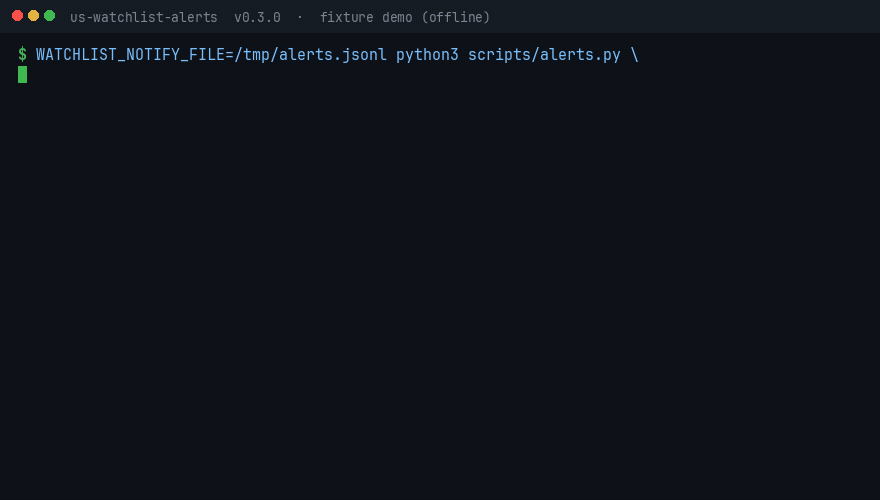

# us-watchlist-alerts

[](https://github.com/eli-alvarado/us-watchlist-alerts/actions/workflows/ci.yml)

Open-source **Agent Skills** for a **US stock watchlist and price alerts**: track tickers with a thesis, entry, targets and stop; get de-duplicated alerts on price levels, % moves, gaps, 52-week highs/lows, MA crosses, RSI, ATM IV, volume spikes, intraday range and earnings; optionally push them to ntfy, Slack, a webhook, or the Linux desktop; and get morning/close briefs. Aware of NYSE hours, pre/after-market, early closes and holidays, in US/Eastern time.

Works in **Claude Code, Codex CLI, Cursor, Gemini CLI** and any agent that reads `SKILL.md`. **No API keys or MCP required.** Default path is the Python standard library plus the unofficial Yahoo Finance chart endpoint. `yfinance`, Alpaca, Finnhub, Alpha Vantage, `alpaca-mcp-server` and `tradingview-mcp` are optional.

> **Not financial advice.** The skills tell the agent to **never place, modify or cancel a trade without your explicit confirmation of that specific order**, and to give no buy/sell recommendations. Free market data may be delayed ~15 minutes. Use at your own risk.



Demo above is **offline**, driven by `tests/fixtures/` (the same data CI uses). It shows the after-hours banner (`market closed, showing last regular close`) and a second run that stays silent. Live Yahoo/yfinance numbers will differ and may be delayed ~15 minutes.

## With vs. without the skill

**Same 3 important moves caught. 58 duplicate pings avoided.**

Fewer alerts here is the point. The skill is not “worse at finding news” — it found every distinct event on the tape and then stayed quiet. A check that has no memory re-sends the same two headlines every 15 minutes, including after the close and on Saturday.

### One trading day, checked every 15 minutes (replayed)

**Replayed** Yahoo 15-minute prices for Thursday **2026-10-15** (not live), plus one Saturday tick. Same watch list both sides: tell me if AAPL is over $340, or if NVDA/SPY drops 3% (last print **or** the session low). Offline: `python3 docs/demo/heartbeat/replay.py`.


| When | What was actually new | With the skill | Without (no memory) |
|---|---|---|---|
| 09:30 | AAPL over $340. NVDA already −3.7% on the low | 2 pings (the news) | 2 pings |
| 09:45 | NVDA’s last print also −3.3% | 1 ping (the news) | 3 pings (2 of them repeats) |
| 10:00–15:45 | Nothing new. Same two conditions still true | quiet | **50 more pings** |
| After 4:00 PM | Market closed | quiet | 6 more pings |
| Saturday | Market closed | quiet | 2 more pings |
| **All day** | **3 real events** | **3 pings** | **61 pings** (3 news + **58 repeats**) |

The skill did **not** miss a real event. NVDA’s low ticked from −3.70% to −3.82% at 09:45; that is the same “down 3% on the low” headline, not a fourth event. 8 of the 58 repeats arrived after the bell or on Saturday.

Default “down 3% today” still means **last price vs yesterday’s close**. The session-low rule is opt-in (`intraday_low_pct`). Full audit: [docs/demo/heartbeat/](docs/demo/heartbeat/).

### One-shot questions (same day, ~6:50 PM ET, Cursor Grok 4.6)

On a **single** question, a capable agent without the skill is fine — live prices, official NYSE calendar. Unedited transcripts: [`docs/demo/`](docs/demo/). The skill’s edge is the next 20 checks, not the first one.

## What's inside

| Skill | What it does |
|---|---|
| [`watchlist-manager`](skills/watchlist-manager/SKILL.md) | Add, remove, update, list and validate tickers with thesis, entry, targets, stop, tags and alert rules (JSON/YAML schema) |
| [`price-alerts`](skills/price-alerts/SKILL.md) | 26 alert types, latching, cooldowns, once-per-day events, session gating, NYSE calendar, optional notify sinks |
| [`watchlist-brief`](skills/watchlist-brief/SKILL.md) | Morning or close summary: table, movers, distance to stop/target, upcoming earnings |
| [`HEARTBEAT.md`](HEARTBEAT.md) | Checklist for a scheduled check that stays silent unless something new happens |

Scripts (`scripts/`, stdlib only): `quotes.py` (multi-provider quote fetcher with fallback), `alerts.py` (rule evaluator + `.alert_state.json` cooldown state), `notify.py` (webhook / Slack / ntfy / desktop / file), `watchlist.py` (CRUD + validation), `brief.py`, `market_calendar.py`, `indicators.py`.

## Quick start

One-line install that **ships the scripts** (no extra clone):

```bash
npx skills add eli-alvarado/us-watchlist-alerts -y
```

Then run them from the skill folder the installer just created (stdlib, no keys):

```bash
python3 .agents/skills/price-alerts/scripts/quotes.py AAPL
python3 .agents/skills/price-alerts/scripts/alerts.py --watchlist .agents/skills/price-alerts/examples/watchlist.json
```

If your agent uses `.cursor/skills` (or another path), swap the prefix — `scripts/` is always next to that skill's `SKILL.md`.

Or clone the repo and use the same files at the root:

```bash
git clone --depth 1 https://github.com/eli-alvarado/us-watchlist-alerts && cd us-watchlist-alerts
cp examples/watchlist.json watchlist.json
python3 scripts/quotes.py AAPL NVDA
python3 scripts/alerts.py
python3 scripts/brief.py --kind morning
python3 -m unittest discover -s tests      # offline, fixtures only
```

After the bell you do **not** need `--force-session`. `alerts.py` evaluates the last regular close and prints `market closed, showing last regular close`. Weekends and full-day holidays stay silent (with the next session date).

Offline demo (no network, same output as the GIF — after-hours last-close mode):

```bash
WATCHLIST_NOTIFY_FILE=/tmp/alerts.jsonl python3 scripts/alerts.py \
  --watchlist tests/fixtures/watchlist.json --fixture tests/fixtures/quotes.json \
  --now 2026-10-15T18:30:00-04:00 --state /tmp/wl-state.json --notify file
python3 scripts/brief.py --watchlist tests/fixtures/watchlist.json \
  --fixture tests/fixtures/quotes.json --kind close --now 2026-10-15T16:15:00-04:00
```

## Example output

### Price alerts (fixture, after hours — last regular close)

```text
[2026-10-15 18:30 ET] session=after — market closed, showing last regular close
ALERT AAPL $241.50 is above $240.00
ALERT AAPL within 0.0% of 52w high $241.50
ALERT AAPL reports earnings in 14 day(s) (2026-10-29)
ALERT TSLA down -6.00% today
ALERT TSLA gapped down -5.00% (open $212.55)
ALERT TSLA volume 3.0x 20-day avg
ALERT TSLA RSI 28.8 <= 30
ALERT TSLA reports earnings in 1 day(s) (2026-10-16)
ALERT NVDA golden cross: SMA50 vs SMA200
NOTIFY file /tmp/alerts.jsonl
```

A second run in the same session prints `no new alerts` until a level re-arms or the next trading day (daily events). Agents running [HEARTBEAT.md](HEARTBEAT.md) stay silent when the list is empty. `--notify` / `WATCHLIST_NOTIFY` also stay silent on empty, skipped, and `--dry-run` runs.

### Live after hours (2026-10-15, delayed Yahoo chart — snapshot)

No `--force-session`. Crumb worked: AAPL earnings `2026-11-02` (`yahoo-calendar`), ATM IV 22.4% (`yahoo-options`). Nasdaq agreed on AAPL (`2026-11-02`) when Yahoo layers were forced off. SPY (an ETF) has no earnings date — the CLI now says so in one line instead of dumping a Yahoo 404 body.

```text
[2026-10-15 18:45 ET] session=after — market closed, showing last regular close
ALERT AAPL $342.00 is above $240.00
ALERT AAPL within 1.8% of 52w high $348.15
ALERT AAPL $342.00 reached target $250.00
ALERT AAPL $342.00 reached target $270.00
ALERT NVDA $217.23 reached target $190.00
```

```text
AAPL  $342.00  −0.28% vs prev_close $342.96   earnings 2026-11-02 (yahoo-calendar)   ATM IV 22.4% exp 2026-10-16
SPY   $771.79  +0.28%                         earnings unavailable (ETF)            ATM IV 1.8% exp 2026-10-15 (0DTE)
NVDA  $217.23  −1.84%                         earnings 2026-11-17 (yahoo-calendar)   ATM IV 34.8% exp 2026-10-16
```

`prev_close` is yesterday, not the 1y chart range start (that bug was v0.3.1). SPY's 1.8% IV is nearest-expiry on expiration day after the bell — a remaining limitation, not a crumb failure.

### Watchlist brief (fixture, morning)

```markdown
# Watchlist morning brief - Thu Oct 15, 2026 08:30 AM ET

| Ticker | Price | Chg | RSI14 | Trend | To stop | To target 1 |
|---|---|---|---|---|---|---|
| AAPL | $241.50 | +1.76% | 73 | up (50>200) | +13.0% | +3.5% |
| TSLA | $210.32 | -6.00% | 29 | down (50<200) | - | - |
| NVDA | $169.80 | +1.31% | 99 | up (50>200) | +17.6% | +11.9% |

**Biggest movers:** TSLA -6.0%, AAPL +1.8%, NVDA +1.3%
**Earnings dates:** TSLA (2026-10-16), AAPL (2026-10-29)

_Data: fixture. Informational only - not financial advice._
```

"To stop" is remaining cushion (positive = room left). Live runs label the data source (`yahoo-chart`, `yfinance`, …) instead of `fixture`.

## Install per agent

Python **3.10+** is tested in CI. Each skill folder includes `scripts/` (same files as the repo root).

Universal installer ([skills.sh](https://skills.sh)):

```bash
npx skills add eli-alvarado/us-watchlist-alerts -y
```

Pass `-a claude-code`, `-a cursor`, `-a copilot`, or `-a gemini-cli` to pick an agent path. Scripts land next to `SKILL.md` in that path.

### Claude Code

Plugin (this repo is a marketplace):

```text
/plugin marketplace add eli-alvarado/us-watchlist-alerts
/plugin install us-watchlist-alerts
```

Or symlink into the user skills dir:

```bash
git clone https://github.com/eli-alvarado/us-watchlist-alerts ~/.claude/us-watchlist-alerts
mkdir -p ~/.claude/skills
for s in watchlist-manager price-alerts watchlist-brief; do
  ln -sfn ~/.claude/us-watchlist-alerts/skills/$s ~/.claude/skills/$s
done
```

For one project, use `.claude/skills/` instead. Then ask: `add NVDA to my watchlist with a stop at 140`.

### Codex CLI

```bash
git clone https://github.com/eli-alvarado/us-watchlist-alerts ~/.codex/us-watchlist-alerts
mkdir -p ~/.codex/skills
for s in watchlist-manager price-alerts watchlist-brief; do
  ln -sfn ~/.codex/us-watchlist-alerts/skills/$s ~/.codex/skills/$s
done
```

Or point the project's `AGENTS.md` at `skills/*/SKILL.md` and run scripts from the clone.

### Cursor

Project (committed with the repo you work in):

```bash
mkdir -p .cursor/skills
for s in watchlist-manager price-alerts watchlist-brief; do
  ln -sfn /path/to/us-watchlist-alerts/skills/$s .cursor/skills/$s
done
```

User-wide: the same loop into `~/.cursor/skills/`. Older Cursor versions can use a rule in `.cursor/rules/` that points at the `SKILL.md` files.

### Gemini CLI

```bash
git clone https://github.com/eli-alvarado/us-watchlist-alerts ~/.gemini/us-watchlist-alerts
mkdir -p ~/.gemini/skills
for s in watchlist-manager price-alerts watchlist-brief; do
  ln -sfn ~/.gemini/us-watchlist-alerts/skills/$s ~/.gemini/skills/$s
done
```

Or add `@skills/price-alerts/SKILL.md` (and the sibling skills) to `GEMINI.md`.

### Any other agent

Load the three `SKILL.md` files as instructions, give the agent shell access to `python3 scripts/...` from the repo root, and run [HEARTBEAT.md](HEARTBEAT.md) on your scheduler.

## Scheduling

Run the HEARTBEAT checklist every 15–30 min during market hours, or use cron (times in ET):

```cron
CRON_TZ=America/New_York
*/15 9-16 * * 1-5  cd ~/us-watchlist-alerts && python3 scripts/alerts.py >> alerts.log
45 8 * * 1-5       cd ~/us-watchlist-alerts && python3 scripts/brief.py --kind morning
10 16 * * 1-5      cd ~/us-watchlist-alerts && python3 scripts/brief.py --kind close
```

`alerts.py` skips weekends, regular NYSE holidays, dates in [`data/holidays_overrides.json`](data/holidays_overrides.json), `settings.extra_closures` / `NYSE_EXTRA_CLOSURES`, and (when Alpaca keys are set) weekdays missing from Alpaca's official calendar. That overlay is **disk-cached for the ET day** (`.nyse_calendar_cache.json`) so a 15-minute cron does not call `/v2/calendar` every tick.

### Alert delivery (no auto-trade)

Push **new** alerts off-box without involving a broker:

```bash
export WATCHLIST_NOTIFY=ntfy,slack          # any of: webhook, slack, ntfy, desktop, file
export NTFY_TOPIC=my-watchlist              # default host https://ntfy.sh ; optional NTFY_URL / NTFY_TOKEN
export SLACK_WEBHOOK_URL=https://hooks.slack.com/services/...
python3 scripts/alerts.py --notify          # or pass --notify ntfy
```

| Sink | Env | Notes |
|---|---|---|
| `webhook` | `WATCHLIST_WEBHOOK_URL` | JSON POST `{source, session, count, alerts, text}` |
| `slack` | `SLACK_WEBHOOK_URL` | Incoming webhook `{"text": ...}` |
| `ntfy` | `NTFY_TOPIC` (+ `NTFY_URL`, `NTFY_TOKEN`) | Phone / desktop via [ntfy](https://ntfy.sh) |
| `desktop` | — | Linux `notify-send` only |
| `file` | `WATCHLIST_NOTIFY_FILE` | JSONL, good for tests and local logs |

A downed sink prints `WARN notify …` and the rest still run. This is not order routing.

### Multiple watchlists

`WATCHLIST_FILE` already picks the list; give each profile its own state file so latches do not collide:

```bash
WATCHLIST_FILE=swing.json ALERT_STATE_FILE=.alert_state_swing.json python3 scripts/alerts.py --notify
WATCHLIST_FILE=long.json  ALERT_STATE_FILE=.alert_state_long.json  python3 scripts/alerts.py --notify
```

## Configuration

| Env var | Purpose |
|---|---|
| `WATCHLIST_FILE` | Watchlist path (default `./watchlist.json`) |
| `ALERT_STATE_FILE` | Cooldown state (default `./.alert_state.json`) |
| `WATCHLIST_PROVIDER` | `auto` (default), `alpaca`, `yfinance`, `yahoo`, `finnhub`, `alphavantage` |
| `WATCHLIST_STALE_AFTER` | Seconds before a regular-session quote is flagged stale (default `900`; `0`=off) |
| `WATCHLIST_HTTP_TIMEOUT` | HTTP timeout seconds (default `15`) |
| `NYSE_EXTRA_CLOSURES` | Comma-separated ISO dates for unscheduled full-day closures |
| `NYSE_CALENDAR_CACHE` | Official calendar cache path (default `./.nyse_calendar_cache.json`) |
| `WATCHLIST_NOTIFY` | Comma-separated sinks: `webhook`, `slack`, `ntfy`, `desktop`, `file` |
| `WATCHLIST_WEBHOOK_URL` | Generic JSON webhook |
| `SLACK_WEBHOOK_URL` | Slack incoming webhook |
| `NTFY_TOPIC` / `NTFY_URL` / `NTFY_TOKEN` | ntfy topic, server (default `https://ntfy.sh`), optional bearer token |
| `WATCHLIST_NOTIFY_FILE` | JSONL path for the `file` sink |
| `ALPACA_API_KEY_ID` / `ALPACA_API_SECRET_KEY` | Official Alpaca snapshot + daily bars + trading calendar |
| `ALPACA_API_BASE` | Trading API host for the calendar (default `https://paper-api.alpaca.markets`) |
| `FINNHUB_API_KEY` | Optional Finnhub quotes, candles, and earnings calendar |
| `ALPHAVANTAGE_API_KEY` | Optional Alpha Vantage daily history and earnings calendar |

Watchlist `settings`: `cooldown_minutes`, `rearm_pct`, `sessions` (`regular`/`pre`/`after`), `volume_spike_multiple`, `near_52w_pct`, `earnings_days`, `max_alerts_per_run`, `extra_closures`, `stale_after_seconds`.

## Quote fallback order

For `provider=auto`, first success wins:

1. `--fixture` (tests and the demo GIF)
2. **Alpaca** snapshot + daily bars if both API keys are set (official US feed; history included)
3. **yfinance** if installed
4. **Yahoo** public chart API (`query1`, then `query2`) — unofficial, stdlib, best-effort
5. **Finnhub** quote + candles if `FINNHUB_API_KEY` is set
6. **Alpha Vantage** daily if `ALPHAVANTAGE_API_KEY` is set

Earnings dates are filled **separately** (Yahoo `calendarEvents` with crumb/cookie, then quote HTML, then Nasdaq analyst `earnings-date`, then Finnhub/AV if keyed) so `earnings_within` works without yfinance. ATM IV uses the same crumb, then yfinance if installed. Failures set `earnings_error` / `iv_error` and print a WARN — they do not invent values. HTTP calls retry 429/5xx; quote failures are `QuoteError`s with a provider and hint.

Details: [docs/LIMITATIONS.md](docs/LIMITATIONS.md).

## How the anti-spam works

- **Level alerts** (price, stop, target, RSI, ATM IV) latch after firing and re-arm only after the condition clears (price/IV hysteresis via `rearm_pct` for price levels).
- Each **target** is its own latch, so hitting T1 does not hide T2.
- **Event alerts** (gaps, % moves, volume, crosses, 52-week highs/lows, earnings, intraday range / opt-in session extremes) fire at most once per trading day.
- **Default % checks are last vs prior close.** `pct_change_down: 3` ignores a session low that recovered. Opt-in `intraday_low_pct` / `intraday_extreme_pct` if you want the extreme.
- A **cooldown** applies to every re-fire. `max_alerts_per_run` caps what is printed; omitted alerts are **not** latched, so the next run can emit them.

## Limitations

- **Unscheduled closures** use a bundled list (`data/holidays_overrides.json`, incomplete), plus env/settings overrides, plus an optional Alpaca official calendar overlay (day-cached). The rule-based table still does not invent mourning days on its own.
- **Earnings dates** no longer require yfinance, but Yahoo/Finnhub/AV calendars can be wrong or empty. Confirm against issuer IR.
- The **Yahoo chart / quoteSummary / options endpoints are unofficial** and best-effort. They can change, rate-limit, or return delayed quotes (~15 minutes). ATM IV is nearest-expiry only; there is no IV rank.
- `intraday_range_pct` and `intraday_*_pct` need provider `day_high`/`day_low`. They will not fake a range from the daily close series. `pct_change_*` still uses last vs prior close only.
- Alpaca/Finnhub history depends on bars/candles succeeding; if those calls fail, MA/RSI/52-week rules will not fire even though the last price is present.
- US-listed equities and ETFs only. No order routing. `notify-send` is Linux-only; use ntfy on macOS/Windows.

Full write-up: [docs/LIMITATIONS.md](docs/LIMITATIONS.md). Changelog: [CHANGELOG.md](CHANGELOG.md).

## Comparison

This repo is a **watchlist heartbeat**: schema + NYSE session gate + anti-spam alerts + briefs. The projects below overlap on "finance + agents" but solve different jobs.

| | **us-watchlist-alerts** | [tradermonty/claude-trading-skills](https://github.com/tradermonty/claude-trading-skills) | [himself65/finance-skills](https://github.com/himself65/finance-skills) | [gauss314/skills](https://github.com/gauss314/skills) | [chjm-ai/stock-monitor-skill](https://github.com/chjm-ai/stock-monitor-skill) |
|---|---|---|---|---|---|
| Job | Watchlist, price alerts, morning/close brief | ~70 research, screening, journal, backtest skills | ~25 analysis skills (valuation, earnings, social, yfinance) | Per-source data skills **and broker execution** | Monitor daemon with 7 alert rules |
| Markets | US listed stocks/ETFs | Mostly US research | Global analysis | US + Argentina + global data | **China A-shares**, futures, gold |
| Default data | Stdlib Yahoo chart; Alpaca official if keyed; optional yfinance / Finnhub / AV | Many screeners want FMP or FinViz Elite | yfinance + various APIs | One skill per vendor; keys vary | A-share feeds |
| Auto-trade | **Never** (hard rule in every skill) | Research / discipline, not a 15-min alerter | Analysis, not latching alerts | **Places Alpaca orders** | Alerts only |
| Session logic | NYSE hours, early closes, holidays, extra closures | Not this repo's job | Not this repo's job | Alpaca calendar inside the trading skill | Beijing time, A-share sessions |
| Anti-spam | Latch + rearm + once-per-day + cooldown | n/a | n/a | n/a | Severity tiers + polling |
| China / A-shares | No | No | No | No | **Yes** (this US repo was inspired by that shape) |

Use **tradermonty** or **himself65** for research. Use **gauss314** when you intentionally want a broker skill. Use **chjm-ai** for A-shares. Use **this** when you want a tiny, keyed-optional US list that an agent can check on a timer without spamming you or firing orders.

## Tests and CI

```bash
python3 -m unittest discover -s tests
```

No network, no extra pip packages. GitHub Actions runs that command on Python 3.10, 3.11, 3.12 and 3.13.

## Contributing and growth

- [CONTRIBUTING.md](CONTRIBUTING.md) — tests, PR bar, good first issues
- [GROWTH_PLAN.md](GROWTH_PLAN.md) — marketplaces, awesome-lists, launch posts, v0.4
- [docs/LIMITATIONS.md](docs/LIMITATIONS.md)

MIT © 2026 Eli Alvarado
