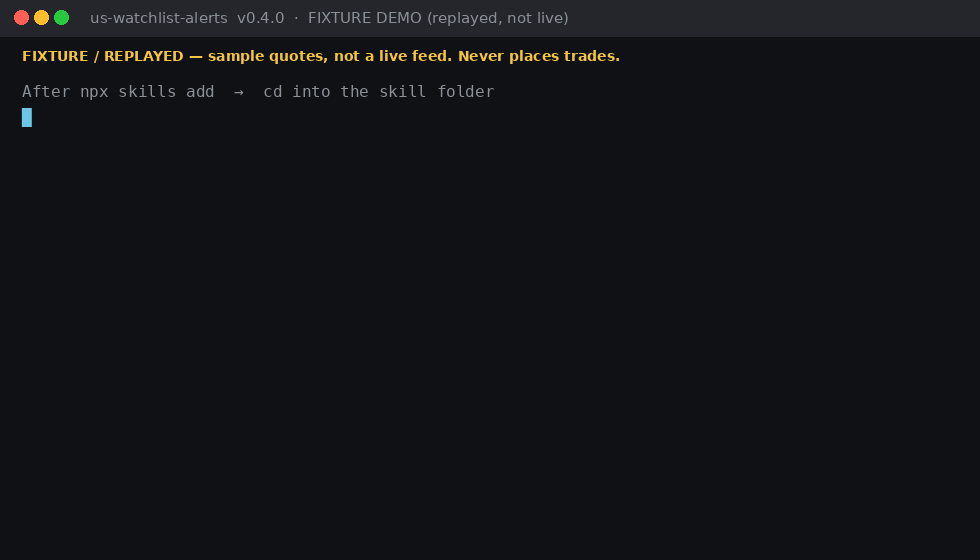
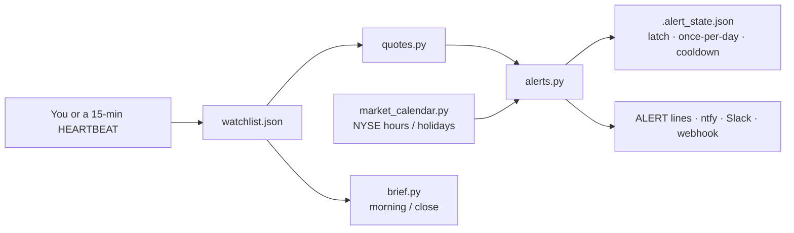

# US Stock Watchlist & Price Alerts: Agent Skills for Claude Code, Codex, Gemini CLI, and Cursor

[](https://github.com/eli-alvarado/us-watchlist-alerts/actions/workflows/ci.yml) [](https://bsky.app/profile/uswatchlist.bsky.social)

**Featured in:** [awesome-gemini-cli](https://github.com/Piebald-AI/awesome-gemini-cli)

Free, open-source **agent skills** (`SKILL.md` format) for a **US stock watchlist**, **stock price alerts**, a **daily market brief**, and **price charts**, with alerts that know **NYSE market hours and holidays**. Works in Claude Code, Codex, Gemini CLI, Cursor, and any agent that reads `SKILL.md`. Track tickers with a thesis, entry, targets, and stop. Get de-duplicated alerts on price levels, daily % moves, gaps, 52-week highs and lows, moving-average crosses, RSI, ATM IV, volume spikes, intraday range, and earnings, then a morning or close brief. **No API key and no MCP required.** Default path is Python 3 stdlib + the unofficial Yahoo Finance chart. Optional: `yfinance`, Alpaca, Finnhub, Alpha Vantage.

> **Not financial advice.** These skills **never place, modify, or cancel a trade**. Free quotes may be delayed ~15 minutes. Use at your own risk.



About 15 seconds, **fixture / replayed** sample quotes (not a live feed). Same story as `python3 scripts/quickstart.py` after install.

Longer after-hours fixture walkthrough: [docs/demo.gif](docs/demo.gif).

## How it works



You own the list. The scripts fetch a quote, evaluate only **new** conditions, and stay quiet when nothing changed — including after the bell and on Saturday.

## Get alerts on your phone, even with your agent closed

A Claude/Cursor session only runs while it is open. For always-on NYSE-hours checks on a machine that stays on:

```bash
export WATCHLIST_NOTIFY=ntfy
export NTFY_TOPIC=my-watchlist          # install the ntfy app and subscribe to this topic
python3 scripts/schedule.py             # or: python3 scripts/quickstart.py schedule
```

That installs a **weekday** cron job (every 5 minutes, Mon–Fri) whose working directory is the **watchlist data dir** (project `./` or `~/.config/us-watchlist-alerts/`), not the skill folder. `alerts.py` already stays silent on NYSE holidays, weekends, and empty checks, so off-hours ticks do not ping you. Daily events are de-duplicated by the **session date of the last close**, so a 00:05 run does not re-fire yesterday as “today.” `--dry-run` prints the job without installing or sending a test ping. `python3 scripts/schedule.py uninstall` removes it. On Windows the same command **prints** a Task Scheduler line that `cd`s into that data dir (it does not create the task).

No always-on computer? In a **private fork**, copy [`examples/alerts-cron.yml`](examples/alerts-cron.yml) to `.github/workflows/alerts.yml` and set `NTFY_TOPIC` (or Slack/webhook) as Actions secrets. Do **not** put notify secrets on this public repo — [`.github/workflows/live.yml`](.github/workflows/live.yml) is a no-secrets public snapshot, not your phone.

Never places trades.

## FAQ

**What does it cost?** Free. No API key for the default Yahoo chart path. Optional Alpaca / Finnhub / Alpha Vantage keys are only if you want those feeds.

**Does it place trades?** No. Every `SKILL.md` and [SECURITY.md](SECURITY.md) say the agent must never place, modify, or cancel an order without your explicit confirmation of that specific order. There is no broker submit path in this repo.

**Where does my data go?** `$WATCHLIST_FILE` if set, else `./watchlist.json` in your **project** directory (the same file if you `cd` into `.claude/skills/<name>` or `.agents/skills/<name>` — the scripts walk up to the project root), else `~/.config/us-watchlist-alerts/watchlist.json` (Windows: `%APPDATA%\us-watchlist-alerts\`). Alert state defaults to `.alert_state.json` next to that file. `watchlist.py init` / `add` / `list` print `using <path>` so you can see which file was chosen. That location is shared by all three skills and is **not** inside the skill folder, so `npx skills add` (reinstall/update) cannot delete it. Outbound HTTPS is quotes and (if you enable them) notify sinks. Keys belong in the environment, never in the watchlist file. See [SECURITY.md](SECURITY.md).

**What data sources?** Default: unofficial Yahoo Finance chart (stdlib). Fallback order and earnings/IV layers: [docs/LIMITATIONS.md](docs/LIMITATIONS.md). Quotes may be delayed ~15 minutes. US-listed stocks and ETFs only.

**Why did I get fewer alerts with the skill?** That is the point. Same distinct events, no duplicate pings — see [With vs. without](#with-vs-without-the-skill).

**Claude Code install landed in `.agents/skills`?** You used bare `-y`. Use `-a claude-code` so it writes `.claude/skills/`. See [Quick start](#quick-start).

**Windows: `ZoneInfoNotFoundError`?** `pip install tzdata`. Linux CI does not need it.

## With vs. without the skill

**Same 3 important moves caught. 58 duplicate pings avoided.**

Fewer alerts here is the point. The skill is not “worse at finding news” — it found every distinct event on the tape and then stayed quiet. A check that has no memory re-sends the same two headlines every 15 minutes, including after the close and on Saturday.

### One trading day, checked every 15 minutes (replayed)

**Replayed** Yahoo 15-minute prices for Thursday **2026-10-15** (not live), plus one Saturday tick. Same watch list both sides: tell me if AAPL is over $340, or if NVDA/SPY drops 3% (last print **or** the session low). Offline: `python3 docs/demo/heartbeat/replay.py`.


| When | What was actually new | With the skill | Without (no memory) |
|---|---|---|---|
| 09:30 | AAPL over $340. NVDA already −3.7% on the low | 2 pings (the news) | 2 pings |
| 09:45 | NVDA’s last print also −3.3% | 1 ping (the news) | 3 pings (2 of them repeats) |
| 10:00–15:45 | Nothing new. Same two conditions still true | quiet | **50 more pings** |
| After 4:00 PM | Market closed | quiet | 6 more pings |
| Saturday | Market closed | quiet | 2 more pings |
| **All day** | **3 real events** | **3 pings** | **61 pings** (3 news + **58 repeats**) |

The skill did **not** miss a real event. NVDA’s low ticked from −3.70% to −3.82% at 09:45; that is the same “down 3% on the low” headline, not a fourth event. 8 of the 58 repeats arrived after the bell or on Saturday.

Default “down 3% today” still means **last price vs yesterday’s close**. The session-low rule is opt-in (`intraday_low_pct`). Full audit: [docs/demo/heartbeat/](docs/demo/heartbeat/).

### One-shot questions (same day, ~6:50 PM ET, Cursor Grok 4.6)

On a **single** question, a capable agent without the skill is fine — live prices, official NYSE calendar. Unedited transcripts: [`docs/demo/`](docs/demo/). The skill’s edge is the next 20 checks, not the first one.

## What's inside

| Skill | What it does |
|---|---|
| [`watchlist-manager`](skills/watchlist-manager/SKILL.md) | Add, remove, update, list and validate tickers with thesis, entry, targets, stop, tags and alert rules (JSON/YAML schema) |
| [`price-alerts`](skills/price-alerts/SKILL.md) | 26 alert types + 1 alias (`intraday_extreme_pct`), latching, cooldowns, once-per-day events, session gating, NYSE calendar, optional notify sinks |
| [`watchlist-brief`](skills/watchlist-brief/SKILL.md) | Morning or close summary: table, movers, distance to stop/target, upcoming earnings; optional `chart.py` (ASCII / PNG) |
| [`HEARTBEAT.md`](HEARTBEAT.md) | Checklist for a scheduled check that stays silent unless something new happens |

Scripts (`scripts/`, stdlib only): `quotes.py` (multi-provider quote fetcher with fallback), `alerts.py` (rule evaluator + `.alert_state.json` cooldown state), `notify.py` (webhook / Slack / ntfy / desktop / file), `watchlist.py` (CRUD + validation + `init`), `brief.py`, `chart.py` (ASCII sparkline / grid; PNG when matplotlib is installed), `market_calendar.py`, `indicators.py`, `quickstart.py` (offline fixture demo after install), `schedule.py` (weekday cron / Task Scheduler for always-on checks).

## Quick start

Pick **one** installer line. Bare `-y` is **not** Claude Code — it writes `.agents/skills/` (Cursor / Codex). Claude Code needs `-a claude-code`.

| Agent | Command (copy exactly) | Lands in |
|---|---|---|
| **Claude Code** | `npx skills add eli-alvarado/us-watchlist-alerts -y -a claude-code` | `.claude/skills/` |
| **Cursor** | `npx skills add eli-alvarado/us-watchlist-alerts -y -a cursor` | `.agents/skills/` |
| **Codex** | `npx skills add eli-alvarado/us-watchlist-alerts -y -a codex` | `.agents/skills/` |
| **Gemini CLI** | `npx skills add eli-alvarado/us-watchlist-alerts -y -a gemini-cli` | `.agents/skills/` |
| Every agent in this folder | `npx skills add eli-alvarado/us-watchlist-alerts --all` | `.agents/skills/` plus a `.claude/skills/` symlink |

Run scripts **from the project root by path** (do not `cd` into the skill folder — `npx skills add` replaces that directory and would delete a watchlist stored there):

```bash
# Claude Code
python3 .claude/skills/price-alerts/scripts/quickstart.py
python3 .claude/skills/price-alerts/scripts/quotes.py AAPL
# Cursor / Codex / Gemini CLI: .agents/skills/price-alerts/scripts/...
```

`quickstart.py` reads the bundled example **in place** for the fixture demo and never writes `watchlist.json`. `watchlist.py init` writes an **empty** list at the shared default path so a first `add NVDA` succeeds. All three skills use the same file: `$WATCHLIST_FILE`, else `./watchlist.json` in this project (also when cwd is `.claude/skills/<name>` or `.agents/skills/<name>`), else `~/.config/us-watchlist-alerts/watchlist.json`. Pass `--example` only if you want the sample book (a live ~$342 AAPL print will fire those fixture-era levels once):

```bash
python3 .claude/skills/watchlist-manager/scripts/watchlist.py init
python3 .claude/skills/watchlist-manager/scripts/watchlist.py add AAPL --alert pct_change_down:3
python3 .claude/skills/price-alerts/scripts/alerts.py
```

`--file` can sit before or after the subcommand. If `alerts.py` has no watchlist file, it tells you to run `init` instead of printing a silent “no new alerts.”

Or clone the repo and use the same files at the root:

```bash
git clone --depth 1 https://github.com/eli-alvarado/us-watchlist-alerts && cd us-watchlist-alerts
python3 scripts/quickstart.py              # fixture demo
python3 scripts/quotes.py AAPL NVDA        # live
python3 -m unittest discover -s tests      # offline, fixtures only
```

On Windows, if that raises `ZoneInfoNotFoundError` for `America/New_York`, run `pip install tzdata`. Do not add `tzdata` to Linux CI or `requirements.txt`.

After the bell you do **not** need `--force-session`. `alerts.py` evaluates the last regular close and prints `market closed, showing last regular close`. Weekends and full-day holidays stay silent (with the next session date).

Offline demo (no network, same output as the GIF — after-hours last-close mode):

```bash
WATCHLIST_NOTIFY_FILE=/tmp/alerts.jsonl python3 scripts/alerts.py \
  --watchlist tests/fixtures/watchlist.json --fixture tests/fixtures/quotes.json \
  --now 2026-10-15T18:30:00-04:00 --state /tmp/wl-state.json --notify file
python3 scripts/brief.py --watchlist tests/fixtures/watchlist.json \
  --fixture tests/fixtures/quotes.json --kind close --now 2026-10-15T16:15:00-04:00
python3 scripts/brief.py --watchlist tests/fixtures/watchlist.json \
  --fixture tests/fixtures/quotes.json --kind morning --now 2026-10-15T08:30:00-04:00 --format json
python3 scripts/chart.py AAPL --watchlist tests/fixtures/watchlist.json \
  --fixture tests/fixtures/quotes.json
```

### Use it in ChatGPT, Grok Bot, or other chat agents

You don't need a terminal if your chat assistant can load skills and has its own computer to run code. Grok Bot works today: we tested the skills there, and on Python 3.10+ they pull live Yahoo prices, keep your watchlist, fire alerts and write briefs, with nothing extra to install and no API key. ChatGPT supports uploading skills in this same format on Business, Enterprise and Edu plans, but we haven't tested it there, and its sandbox may block the live price lookups (the bundled sample data still works offline). Once the skill is added, just chat normally, for example "watch NVDA and tell me if it drops below 140" or "give me my morning brief." It's for information only: it never places trades.

## Example output

### Price alerts (fixture, after hours — last regular close)

```text
[2026-10-15 18:30 ET] session=after — market closed, showing last regular close
ALERT AAPL $241.50 is above $240.00
ALERT AAPL within 0.0% of 52w high $241.50
ALERT AAPL reports earnings in 14 day(s) (2026-10-29)
ALERT TSLA down -6.00% today
ALERT TSLA gapped down -5.00% (open $212.55)
ALERT TSLA volume 3.0x 20-day avg
ALERT TSLA RSI 28.8 <= 30
ALERT TSLA reports earnings in 1 day(s) (2026-10-16)
ALERT NVDA golden cross: SMA50 vs SMA200
NOTIFY file /tmp/alerts.jsonl
```

A second run in the same session prints `no new alerts` until a level re-arms or the next trading day (daily events). Agents running [HEARTBEAT.md](HEARTBEAT.md) stay silent when the list is empty. `--notify` / `WATCHLIST_NOTIFY` also stay silent on empty, skipped, and `--dry-run` runs.

### Live after hours (2026-10-15 ~18:45 ET, yahoo-chart)

Last regular close vs **Wednesday 2026-10-14** prior close (AAPL $342.96, NVDA $221.30, SPY $769.60). Source: delayed Yahoo chart, no `--force-session`. Same last prints as the weekday Action at 20:09 ET; that first snapshot used Tuesday 2026-10-13 as `prev_close` because a trailing today-bar with `close: None` was treated as “today” (fixed in 0.4.1).

Crumb worked: AAPL earnings `2026-11-02` (`yahoo-calendar`), ATM IV 22.4% (`yahoo-options`). Nasdaq agreed on AAPL (`2026-11-02`) when Yahoo layers were forced off. SPY (an ETF) has no earnings date — the CLI now says so in one line instead of dumping a Yahoo 404 body.

```text
[2026-10-15 18:45 ET] session=after — market closed, showing last regular close
ALERT AAPL $342.00 is above $240.00
ALERT AAPL within 1.8% of 52w high $348.15
ALERT AAPL $342.00 reached target $250.00
ALERT AAPL $342.00 reached target $270.00
ALERT NVDA $217.23 reached target $190.00
```

```text
AAPL  $342.00  −0.28% vs prev_close $342.96   earnings 2026-11-02 (yahoo-calendar)   ATM IV 22.4% exp 2026-10-16
SPY   $771.79  +0.28%                         earnings unavailable (ETF)            ATM IV 1.8% exp 2026-10-15 (0DTE)
NVDA  $217.23  −1.84%                         earnings 2026-11-17 (yahoo-calendar)   ATM IV 34.8% exp 2026-10-16
```

`prev_close` is yesterday, not the 1y chart range start (that bug was v0.3.1). SPY's 1.8% IV is nearest-expiry on expiration day after the bell — a remaining limitation, not a crumb failure.

### Watchlist brief (fixture, morning)

```markdown
# Watchlist morning brief - Thu Oct 15, 2026 08:30 AM ET

| Ticker | Price | Chg | RSI14 | Trend | To stop | To target 1 |
|---|---|---|---|---|---|---|
| AAPL | $241.50 | +1.76% | 73 | up (50>200) | +13.0% | +3.5% |
| TSLA | $210.32 | -6.00% | 29 | down (50<200) | - | - |
| NVDA | $169.80 | +1.31% | 99 | up (50>200) | +17.6% | +11.9% |

**Biggest movers:** TSLA -6.0%, AAPL +1.8%, NVDA +1.3%
**Earnings dates:** TSLA (2026-10-16), AAPL (2026-10-29)

_Data: fixture. Informational only - not financial advice._
```

Use `--format json` to get the same ticker rows, biggest movers, earnings dates, and quote source as a machine-readable object.

"To stop" is remaining cushion (positive = room left). Live runs label the data source (`yahoo-chart`, `yfinance`, …) instead of `fixture`.

**What does the bundled example do on live quotes?** It is a fixture-era book (AAPL above $240). A live AAPL ~$342 will fire those level alerts once. Default `init` is an empty live list; `init --example` is the sample.

## Install per agent

Python **3.10+** is tested in CI. Each skill folder includes `scripts/` (same files as the repo root). Use the **exact** `-a` line from [Quick start](#quick-start) — do not use bare `-y` for Claude Code. Windows only: `pip install tzdata` if `zoneinfo` cannot find `America/New_York`.

### Claude Code

Plugin (this repo is a marketplace):

```text
/plugin marketplace add eli-alvarado/us-watchlist-alerts
/plugin install us-watchlist-alerts
```

Or symlink into the user skills dir:

```bash
git clone https://github.com/eli-alvarado/us-watchlist-alerts ~/.claude/us-watchlist-alerts
mkdir -p ~/.claude/skills
for s in watchlist-manager price-alerts watchlist-brief; do
  ln -sfn ~/.claude/us-watchlist-alerts/skills/$s ~/.claude/skills/$s
done
```

For one project, the installer line above already writes `.claude/skills/`. Then ask: `add NVDA to my watchlist with a stop at 140`.

### Codex CLI

Project install (verified): `npx skills add eli-alvarado/us-watchlist-alerts -y -a codex` → `.agents/skills/`.

User-wide symlink if you prefer `~/.codex/skills`:

```bash
git clone https://github.com/eli-alvarado/us-watchlist-alerts ~/.codex/us-watchlist-alerts
mkdir -p ~/.codex/skills
for s in watchlist-manager price-alerts watchlist-brief; do
  ln -sfn ~/.codex/us-watchlist-alerts/skills/$s ~/.codex/skills/$s
done
```

Or point the project's `AGENTS.md` at `skills/*/SKILL.md` and run scripts from the clone.

### Cursor

Project install (verified): `npx skills add eli-alvarado/us-watchlist-alerts -y -a cursor` → `.agents/skills/`.

To also commit a `.cursor/skills/` copy in the repo you work in:

```bash
mkdir -p .cursor/skills
for s in watchlist-manager price-alerts watchlist-brief; do
  ln -sfn /path/to/us-watchlist-alerts/skills/$s .cursor/skills/$s
done
```

User-wide: the same loop into `~/.cursor/skills/`. Older Cursor versions can use a rule in `.cursor/rules/` that points at the `SKILL.md` files.

### Gemini CLI

Project install (verified): `npx skills add eli-alvarado/us-watchlist-alerts -y -a gemini-cli` → `.agents/skills/`.

User-wide symlink if you prefer `~/.gemini/skills`:

```bash
git clone https://github.com/eli-alvarado/us-watchlist-alerts ~/.gemini/us-watchlist-alerts
mkdir -p ~/.gemini/skills
for s in watchlist-manager price-alerts watchlist-brief; do
  ln -sfn ~/.gemini/us-watchlist-alerts/skills/$s ~/.gemini/skills/$s
done
```

Or add `@skills/price-alerts/SKILL.md` (and the sibling skills) to `GEMINI.md`.

### Any other agent

Load the three `SKILL.md` files as instructions, give the agent shell access to `python3 scripts/...` from the repo root, and run [HEARTBEAT.md](HEARTBEAT.md) on your scheduler.

## Scheduling

This repo also runs a **public sample** on weekdays via `.github/workflows/live.yml` — session-aware, no secrets. Every run writes the job summary. Dated files go to the [`live-snapshots`](https://github.com/eli-alvarado/us-watchlist-alerts/tree/live-snapshots/docs/live) branch (**never `main`**), at most one per ET weekday. Index: [docs/live/](docs/live/).

One-command always-on: `python3 scripts/schedule.py` (see [Get alerts on your phone](#get-alerts-on-your-phone-even-with-your-agent-closed)). That is weekday cron every 5 minutes plus a notify sink. HEARTBEAT.md is the same loop if an agent session is open.

Manual cron (times in ET) if you would rather write the lines yourself:

```cron
CRON_TZ=America/New_York
*/5 * * * 1-5      cd ~/us-watchlist-alerts && python3 scripts/alerts.py --notify >> alerts.log
45 8 * * 1-5       cd ~/us-watchlist-alerts && python3 scripts/brief.py --kind morning
10 16 * * 1-5      cd ~/us-watchlist-alerts && python3 scripts/brief.py --kind close
```

`alerts.py` skips weekends, regular NYSE holidays, dates in [`data/holidays_overrides.json`](data/holidays_overrides.json), `settings.extra_closures` / `NYSE_EXTRA_CLOSURES`, and (when Alpaca keys are set) weekdays missing from Alpaca's official calendar. That overlay is **disk-cached for the ET day** (`.nyse_calendar_cache.json`) so a 15-minute cron does not call `/v2/calendar` every tick.

### Alert delivery (no auto-trade)

Push **new** alerts off-box without involving a broker:

```bash
export WATCHLIST_NOTIFY=ntfy,slack          # any of: webhook, slack, ntfy, desktop, file
export NTFY_TOPIC=my-watchlist              # default host https://ntfy.sh ; optional NTFY_URL / NTFY_TOKEN
export SLACK_WEBHOOK_URL=https://hooks.slack.com/services/...
python3 scripts/alerts.py --notify          # or pass --notify ntfy
```

| Sink | Env | Notes |
|---|---|---|
| `webhook` | `WATCHLIST_WEBHOOK_URL` | JSON POST `{source, session, count, alerts, text}` |
| `slack` | `SLACK_WEBHOOK_URL` | Incoming webhook `{"text": ...}` |
| `ntfy` | `NTFY_TOPIC` (+ `NTFY_URL`, `NTFY_TOKEN`) | Phone / desktop via [ntfy](https://ntfy.sh) |
| `desktop` | — | Linux `notify-send` only |
| `file` | `WATCHLIST_NOTIFY_FILE` | JSONL, good for tests and local logs |

A downed sink prints `WARN notify …` and the rest still run. This is not order routing.

### Multiple watchlists

`WATCHLIST_FILE` already picks the list; give each profile its own state file so latches do not collide:

```bash
WATCHLIST_FILE=swing.json ALERT_STATE_FILE=.alert_state_swing.json python3 scripts/alerts.py --notify
WATCHLIST_FILE=long.json  ALERT_STATE_FILE=.alert_state_long.json  python3 scripts/alerts.py --notify
```

## Configuration

| Env var | Purpose |
|---|---|
| `WATCHLIST_FILE` | Watchlist path. Default: `./watchlist.json` in a project directory (walks up from `.claude/skills/<name>` / `.agents/skills/<name>`), else `~/.config/us-watchlist-alerts/watchlist.json` (Windows: `%APPDATA%\us-watchlist-alerts\`; `$XDG_CONFIG_HOME/us-watchlist-alerts/` when set). Never the skill folder. |
| `ALERT_STATE_FILE` | Cooldown state (default: `.alert_state.json` next to the watchlist) |
| `WATCHLIST_PROVIDER` | `auto` (default), `alpaca`, `yfinance`, `yahoo`, `finnhub`, `alphavantage` |
| `WATCHLIST_STALE_AFTER` | Seconds before a regular-session quote is flagged stale (default `900`; `0`=off) |
| `WATCHLIST_HTTP_TIMEOUT` | HTTP timeout seconds (default `15`) |
| `NYSE_EXTRA_CLOSURES` | Comma-separated ISO dates for unscheduled full-day closures |
| `NYSE_CALENDAR_CACHE` | Official calendar cache path (default `./.nyse_calendar_cache.json`) |
| `WATCHLIST_NOTIFY` | Comma-separated sinks: `webhook`, `slack`, `ntfy`, `desktop`, `file` |
| `WATCHLIST_WEBHOOK_URL` | Generic JSON webhook |
| `SLACK_WEBHOOK_URL` | Slack incoming webhook |
| `NTFY_TOPIC` / `NTFY_URL` / `NTFY_TOKEN` | ntfy topic, server (default `https://ntfy.sh`), optional bearer token |
| `WATCHLIST_NOTIFY_FILE` | JSONL path for the `file` sink |
| `ALPACA_API_KEY_ID` / `ALPACA_API_SECRET_KEY` | Official Alpaca snapshot + daily bars + trading calendar |
| `ALPACA_API_BASE` | Trading API host for the calendar (default `https://paper-api.alpaca.markets`) |
| `FINNHUB_API_KEY` | Optional Finnhub quotes, candles, and earnings calendar |
| `ALPHAVANTAGE_API_KEY` | Optional Alpha Vantage daily history and earnings calendar |

Watchlist `settings`: `cooldown_minutes`, `rearm_pct`, `sessions` (`regular`/`pre`/`after`), `volume_spike_multiple`, `near_52w_pct`, `earnings_days`, `max_alerts_per_run`, `extra_closures`, `stale_after_seconds`.

## Quote fallback order

For `provider=auto`, first success wins:

1. `--fixture` (tests and the demo GIF)
2. **Alpaca** snapshot + daily bars if both API keys are set (official US feed; history included)
3. **yfinance** if installed
4. **Yahoo** public chart API (`query1`, then `query2`) — unofficial, stdlib, best-effort
5. **Finnhub** quote + candles if `FINNHUB_API_KEY` is set
6. **Alpha Vantage** daily if `ALPHAVANTAGE_API_KEY` is set

Earnings dates are filled **separately** (Yahoo `calendarEvents` with crumb/cookie, then quote HTML, then Nasdaq analyst `earnings-date`, then Finnhub/AV if keyed) so `earnings_within` works without yfinance. ATM IV uses the same crumb, then yfinance if installed. Failures set `earnings_error` / `iv_error` and print a WARN — they do not invent values. HTTP calls retry 429/5xx; quote failures are `QuoteError`s with a provider and hint.

Details: [docs/LIMITATIONS.md](docs/LIMITATIONS.md).

## How the anti-spam works

- **Level alerts** (price, stop, target, RSI, ATM IV) latch after firing and re-arm only after the condition clears (price/IV hysteresis via `rearm_pct` for price levels).
- Each **target** is its own latch, so hitting T1 does not hide T2.
- **Event alerts** (gaps, % moves, volume, crosses, 52-week highs/lows, earnings, intraday range / opt-in session extremes) fire at most once per **session date of the data shown**. Overnight and pre-open ticks (last-close mode) key on the previous session, so they do not re-fire yesterday’s daily events as “today.”
- **Default % checks are last vs prior close.** `pct_change_down: 3` ignores a session low that recovered. Opt-in `intraday_low_pct` / `intraday_extreme_pct` if you want the extreme.
- A **cooldown** applies to every re-fire. `max_alerts_per_run` caps what is printed; omitted alerts are **not** latched, so the next run can emit them.

## Limitations

- **Unscheduled closures** use a bundled list (`data/holidays_overrides.json`, incomplete), plus env/settings overrides, plus an optional Alpaca official calendar overlay (day-cached). The rule-based table still does not invent mourning days on its own.
- **Earnings dates** no longer require yfinance, but Yahoo/Finnhub/AV calendars can be wrong or empty. Confirm against issuer IR.
- The **Yahoo chart / quoteSummary / options endpoints are unofficial** and best-effort. They can change, rate-limit, or return delayed quotes (~15 minutes). ATM IV is nearest-expiry only; there is no IV rank.
- `intraday_range_pct` and `intraday_*_pct` need provider `day_high`/`day_low`. They will not fake a range from the daily close series. `pct_change_*` still uses last vs prior close only.
- Alpaca/Finnhub history depends on bars/candles succeeding; if those calls fail, MA/RSI/52-week rules will not fire even though the last price is present.
- US-listed equities and ETFs only. No order routing. `notify-send` is Linux-only; use ntfy on macOS/Windows.

Full write-up: [docs/LIMITATIONS.md](docs/LIMITATIONS.md). Changelog: [CHANGELOG.md](CHANGELOG.md). Keys and notify URLs: [SECURITY.md](SECURITY.md). Weekday public sample: [docs/live/](docs/live/) (dated files on [`live-snapshots`](https://github.com/eli-alvarado/us-watchlist-alerts/tree/live-snapshots/docs/live)).

## Comparison

This repo is a **watchlist heartbeat**: schema + NYSE session gate + anti-spam alerts + briefs. The projects below overlap on "finance + agents" but solve different jobs.

| | **us-watchlist-alerts** | [tradermonty/claude-trading-skills](https://github.com/tradermonty/claude-trading-skills) | [himself65/finance-skills](https://github.com/himself65/finance-skills) | [gauss314/skills](https://github.com/gauss314/skills) | [chjm-ai/stock-monitor-skill](https://github.com/chjm-ai/stock-monitor-skill) |
|---|---|---|---|---|---|
| Job | Watchlist, price alerts, morning/close brief | ~70 research, screening, journal, backtest skills | ~25 analysis skills (valuation, earnings, social, yfinance) | Per-source data skills **and broker execution** | Monitor daemon with 7 alert rules |
| Markets | US listed stocks/ETFs | Mostly US research | Global analysis | US + Argentina + global data | **China A-shares**, futures, gold |
| Default data | Stdlib Yahoo chart; Alpaca official if keyed; optional yfinance / Finnhub / AV | Many screeners want FMP or FinViz Elite | yfinance + various APIs | One skill per vendor; keys vary | A-share feeds |
| Auto-trade | **Never** (hard rule in every skill) | Research / discipline, not a 15-min alerter | Analysis, not latching alerts | **Places Alpaca orders** | Alerts only |
| Session logic | NYSE hours, early closes, holidays, extra closures | Not this repo's job | Not this repo's job | Alpaca calendar inside the trading skill | Beijing time, A-share sessions |
| Anti-spam | Latch + rearm + once-per-day + cooldown | n/a | n/a | n/a | Severity tiers + polling |
| China / A-shares | No | No | No | No | **Yes** (this US repo was inspired by that shape) |

Use **tradermonty** or **himself65** for research. Use **gauss314** when you intentionally want a broker skill. Use **chjm-ai** for A-shares. Use **this** when you want a tiny, keyed-optional US list that an agent can check on a timer without spamming you or firing orders.

## Tests and CI

```bash
python3 -m unittest discover -s tests
```

No network, no extra pip packages. GitHub Actions runs that command on Python 3.10, 3.11, 3.12 and 3.13.

## Contributing and growth

- [CONTRIBUTING.md](CONTRIBUTING.md) — tests, PR bar, good first issues
- [GROWTH_PLAN.md](GROWTH_PLAN.md) — marketplaces, awesome-lists, launch posts, v0.4
- [docs/LIMITATIONS.md](docs/LIMITATIONS.md)

MIT © 2026 Eli Alvarado
