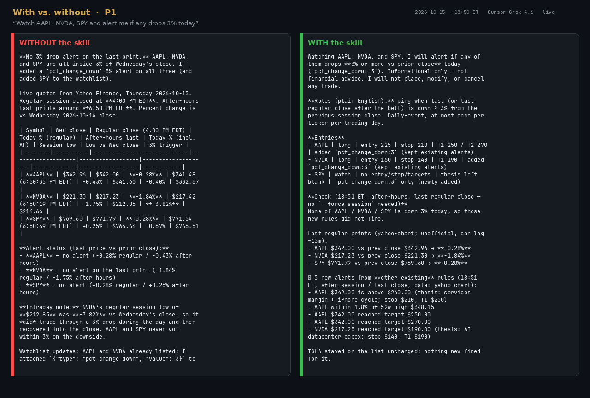
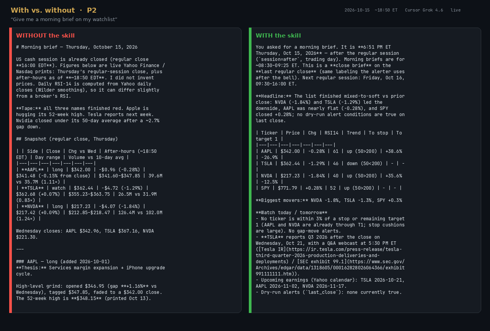
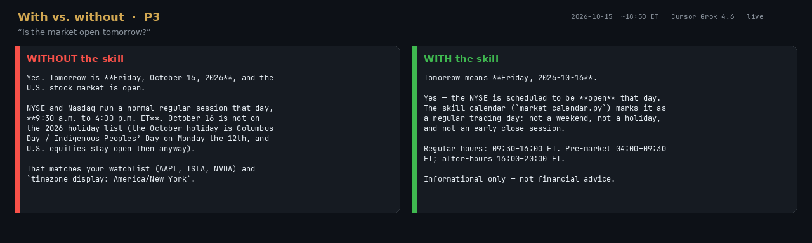
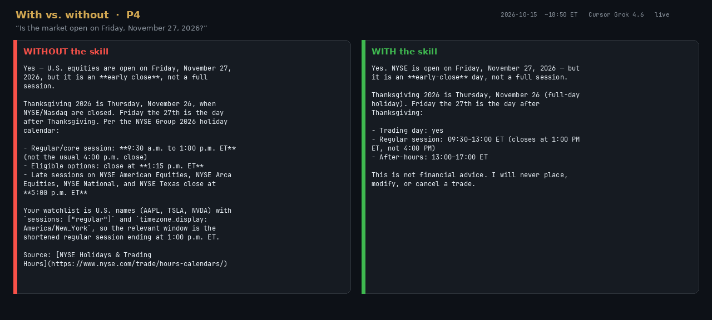

# With vs. without the skill

**Lead with the heartbeat:** [heartbeat/](heartbeat/) — **same 3 important moves; 58 duplicate pings avoided** (61 without-skill pings = 3 first + 58 repeats). One-shot live transcripts below are still honest — a capable agent without the skill is fine on a single turn.

| | |
|---|---|
| **Date** | Thursday 2026-10-15, ~18:50–18:52 ET (regular session closed; `session=after`) |
| **Model** | Cursor Grok 4.6 (`inherit` on Task `generalPurpose` subagents) |
| **Why not a CLI agent** | `claude`, `codex`, `cursor`, and `gemini` CLIs were not installed in this environment |
| **Without** | Isolated `/tmp/demo-without` — `watchlist.json` only. Told not to read `/workspace` or look for `SKILL.md` |
| **With** | Isolated `/tmp/demo-with` — skills copied to `.agents/skills/` plus `AGENTS.md`. Told to follow `SKILL.md` and run the shipped scripts |
| **Data** | Live Yahoo / NYSE web. No `--fixture` |

Full replies: [`transcripts/`](transcripts/). Commands those agents actually ran: [`commands/`](commands/). Side-by-side renders: [`img/`](img/) (images wrap long tables; the markdown files are the source of truth).

**Honest headline:** the without-skill agent did *fine* on every prompt. It fetched live Yahoo prints, computed % change vs prior close, and (for the calendar questions) looked up the official NYSE holiday page. The skill did not “win” by being the only one that could get a price. The difference is the *job*: persist rules, label the session, evaluate the rest of the book, stay silent after hours when that is the right call.

p1 and p2 on the **with** side shared one directory and ran in parallel. p1 wrote SPY into `watchlist.json` and latched alerts in `.alert_state.json`, so p2’s `brief.py` included SPY and its `--dry-run` of `alerts.py` returned no new alerts. That is a real race, not a product bug; it is called out under prompt 2.

## Prompts

1. *Watch AAPL, NVDA, SPY and alert me if any drops 3% today*
2. *Give me a morning brief on my watchlist*
3. *Is the market open tomorrow?*
4. *Is the market open on Friday, November 27, 2026?* (day after Thanksgiving — early close)

Prompt 3 is the user’s “tomorrow” wording. 2026-10-16 is a regular Friday, not a holiday, so prompt 4 is the early-close case.

## Which prompts showed the clearest difference

**Clearest: prompt 1 (3% drop).** Both sides agreed on the last print: AAPL −0.28%, NVDA −1.84%, SPY +0.28% — no 3% close-to-close drop. The without-skill agent also reported NVDA’s **session low $212.85 (−3.82%)** and after-hours last prints; the skill rule `pct_change_down` uses last vs `prev_close` and does not fire on an intraday low that recovered. The with-skill agent persisted `pct_change_down:3` via `watchlist.py`, labeled after-hours last-close, and (because the existing book was evaluated) also emitted five other alerts: AAPL above $240, near 52-week high, both targets, NVDA target $190.

**Next: prompt 2 (morning brief).** Same live closes. Without wrote a long per-ticker “morning brief” after the bell (AH prints, P/E, analyst ratings, hand-checked rules). With refused the morning label — `session=after` — and ran `brief.py --kind close` (standard table, delay note, no-trade line). Session honesty is the skill difference; the without write-up is richer as one-shot research.

**Little difference: prompts 3 and 4.** Both said Friday 2026-10-16 is a regular open (09:30–16:00 ET). Both said Friday 2026-11-27 is an **early close** (1:00 PM ET), Thanksgiving being Thursday the 26th. Without used WebSearch + the [NYSE holiday page](https://www.nyse.com/trade/hours-calendars/) (also mentioned options 1:15 PM and late sessions 5:00 PM). With used `market_calendar.py` offline (regular 09:30–13:00 ET, after-hours to 17:00). Same equity answer; with is local/offline, without is more complete on options/late hours.

## Side-by-side

Animated cycle: [with-vs-without.gif](img/with-vs-without.gif)

## Live prints both sides used (~18:50 ET 2026-10-15, yahoo-chart, last vs Wed 2026-10-14)

| Symbol | Last | Prev close | Day % |
|---|---|---|---|
| AAPL | $342.00 | $342.96 | −0.28% |
| NVDA | $217.23 | $221.30 | −1.84% |
| SPY | $771.79 | $769.60 | +0.28% |
| TSLA | $362.44 | $367.16 | −1.29% |
