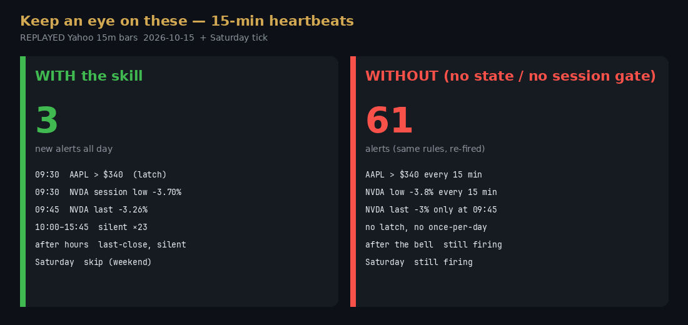

# Heartbeat replay — where the skill actually wins

**REPLAYED data**, not a live feed. 15-minute Yahoo chart bars for Thursday 2026-10-15 (`query1`, `range=5d`, `interval=15m`, `includePrePost=true`), pulled 2026-10-15 ~18:57 ET. `prev_close` is Yahoo `previousClose` (not `chartPreviousClose`). Session high/low are running extremes of those bars. Saturday 2026-10-17 10:00 ET reuses Friday’s last snapshot so the weekend skip is visible.

Reproduce (offline, no keys):

```bash
python3 docs/demo/heartbeat/replay.py
```

CI asserts the counts: **3 alerts with the skill, 61 without**.



## Setup

User request, restated every 15 minutes: *keep an eye on these — ping me if AAPL is above 340 or if NVDA/SPY drops 3% today (including a session low that recovers).*

| Ticker | Rules |
|---|---|
| AAPL | `price_above 340` (level — should latch) |
| NVDA | `pct_change_down: 3` (last vs prior close) **and** opt-in `intraday_low_pct: 3` |
| SPY | same two % rules (never trigger on this tape) |

**With:** `alerts.run` + one `.alert_state.json` + default `sessions=["regular"]` (after-hours = last-close, weekend = skip).

**Without:** the same `evaluate_rule`, but no state and no session gate — a fresh agent turn that only looks at the current quote. That is what happens if there is no skill and no `.alert_state.json`.

A *new chat* at 13:00 that only hears “keep an eye on these” would also lose the 3% rule unless someone persisted the watchlist. The skill writes that file. The numeric demo does not simulate forgetting the rule; it simulates forgetting the **dedupe**.

## What the tape did (replayed)

NVDA prior close **$221.30**. At **09:30** last was −2.59% but the session low was already **−3.70%** ($213.12). At **09:45** last printed **−3.26%** ($214.08) and the low ticked to **−3.82%** ($212.85). Last then recovered to about **−1.8%** into the close. AAPL stayed **$341–$347** all day.

So:

- Default `pct_change_down: 3` fires **once**, at 09:45, when last itself was ≤ −3%.
- Opt-in `intraday_low_pct: 3` fires **once**, at 09:30, on the session low.
- `price_above 340` fires **once**, then latches.

Without state, AAPL>$340 and NVDA’s low re-fire every 15 minutes, including after the bell and on Saturday.

## Counts

See [replay_out.txt](replay_out.txt) (unedited script stdout).

| | With skill | Without |
|---|---|---|
| New alerts | 3 | 61 |
| Silent regular ticks after 09:45 | 23 | 0 |
| After-hours | last-close, silent | 6 more alerts |
| Saturday | skip (`weekend`) | 2 more alerts |

## Files

| File | What |
|---|---|
| [replay_2026-10-15.json](replay_2026-10-15.json) | Labeled snapshots |
| [watchlist.json](watchlist.json) | Rules used |
| [replay.py](replay.py) | Both paths |
| [replay_out.txt](replay_out.txt) | Captured stdout |
| [replay_report.json](replay_report.json) | Machine-readable rows |
